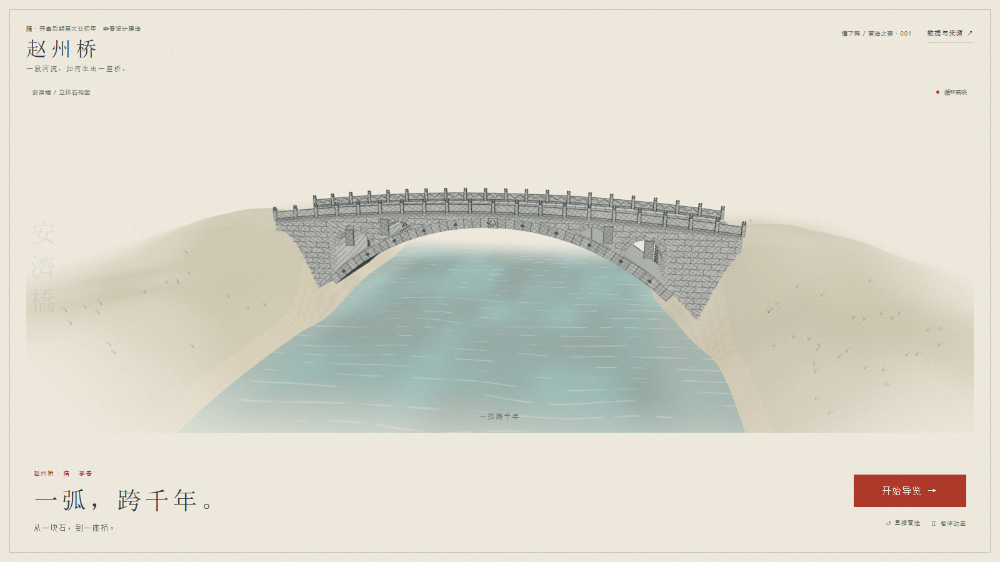

# Arch-bridge

一个面向公众的赵州桥交互科普页面。首页循环展映桥梁营造动画，观众可以从现代地图定位走到洨河两岸，比较桥型，再逐步搭起主拱、敞肩小拱与桥面，追踪荷载抵达两岸的路径。

An interactive public explainer about Zhaozhou Bridge. The opening sequence presents the bridge being assembled; visitors then move from a modern map to the banks of the Xiao River, compare bridge types, build the main arch and open shoulders step by step, and follow the load path to both supports.



## 中文

### 体验内容

- **循环展映**：复用 china-arch 参考页的显式营造顺序与纸上设色逻辑，桥台、28 道拱券、敞肩与桥面依次成形，最后水彩涨色，循环播放。
- **地图启程**：中国 → 河北 → 石家庄 → 赵县，朱色桥址引导定位，石青设色沿行政区轮廓扩散，随后落到洨河两岸。
- **水岸空间**：连续坡岸连接浅滩和道路，动态水纹沿河流动；抬高水位可以观察水面与岸线的关系。
- **桥型比较**：用同一尺度对照梁、多孔拱和单孔拱，观察支点与传力方式。
- **逐步建构**：第一道券从两端相向合拢，镜头升至斜俯视，再从远侧向近侧添入其余券道，呈现沿桥宽并列的 28 道主拱券；四个敞肩小拱逐孔加入，最后补上桥面。
- **传力观察**：跟随“桥面 → 小拱 → 主拱 → 两端支承”的朱色路径理解结构关系。
- **自由观察**：导览结束后可进行横向剖切、设色、结构注记、缓慢环绕和整桥复位。

拖动模型、滚轮或双指会接管镜头；方向键旋转，`+` / `-` 缩放，`Home` 回到整桥。页面支持明暗主题和减少动态效果。

### 本地运行

直接打开 [index.html](index.html) 即可体验。页面已内嵌 Three.js r186.1、现代行政区地图路径和交互代码，不依赖 CDN、地图服务或运行时网络请求。

如需从源码重建入口，在仓库根目录执行：

```powershell
node build.cjs
```

构建源文件位于 [src](src/)：

| 文件 | 作用 |
| --- | --- |
| `src/layout.html` | 页面结构、样式和 UI 壳 |
| `src/player.js` | 章节状态、交互、镜头和主题控制 |
| `src/geometry.js` | 河岸、桥体、拱券和传力可视化几何 |
| `src/maps/` | 现代行政区 GeoJSON 快照及地图说明 |
| `src/vendor/` | 内嵌 Three.js 模块与许可证说明 |
| `src/sources.html` | 页面内来源弹窗内容 |

`build.cjs` 会把源文件和地图数据打包为可直接分享的根目录 `index.html`，并检查构建后的业务脚本语法。

### 资料与严谨性边界

科普内容的来源核验与发布步骤见 [科普交互内容工作流](科普交互内容工作流.md)。事实台账、计算公式、来源摘录和未决问题见 [参考文档.md](参考文档.md)；科普案例研究、八段体验分镜和运镜约束见 [科普调研与体验分镜.md](科普调研与体验分镜.md)。

当前页面采用的主要来源包括：

- [赵县人民政府《赵州桥》](https://www.zhaoxian.gov.cn/columns/7558c04f-250e-4c72-a91c-425e1b5a8a17/202306/26/9c718990-9c93-471a-9e27-20c31de59149.html)：年代、地点、主拱净跨、拱矢、桥面宽度、28 道拱券和小拱跨度。
- [ASCE Historic Landmarks: Zhaozhou Bridge](https://www.asce.org/about-civil-engineering/history-and-heritage/historic-landmarks/zhaozhou-bridge)：敞肩小拱的荷载路径和洪水时的过水空间解释。
- [OpenStreetMap](https://www.openstreetmap.org/#map=15/37.720229/114.763280)：现代桥址位置参考。
- [阿里云 DataV 地图数据选择器](https://datav.aliyun.com/portal/school/atlas/area_selector)：现代行政区 GeoJSON 快照。
- [Three.js](https://threejs.org/)：页面内嵌的开源渲染模块，许可证见 `src/vendor/THIRD_PARTY_NOTICES.md`。

页面明确区分来源直接支持的事实、由事实推导的几何，以及为了教学呈现而设置的示意参数。地图是现代行政区定位，不是隋代行政图；逐券逐孔显现是模型拆解顺序，不是隋代施工记录。公开资料对桥梁总长存在不同口径，页面保留这一差异，不自行推断测量边界。主拱厚度、小拱拱高、局部地形和桥面细部仍属于示意范围。

### 当前状态

2026-10-24 更新：循环展映开场、自然水岸、俯视并券镜头、桥顶净空和精简文案已完成验证。正式预览图见 [preview.png](preview.png)。

## English

### Experience

- **Looping opening film**: The bridge appears in an explicit assembly sequence inspired by the china-arch reference, from abutments and 28 arch ribs to the open shoulders and deck, followed by a watercolor wash.
- **Map to river**: Follow the route China → Hebei → Shijiazhuang → Zhao County, then land at the banks of the Xiao River.
- **River and banks**: Continuous sloped banks, shallow edges, roads and animated water make the crossing problem visible before construction begins.
- **Bridge type comparison**: Compare a beam, a multi-span arch and a single-span arch at the same scale, focusing on supports and load paths.
- **Step-by-step construction**: The first arch rib closes from both ends; the camera rises to reveal the bridge width, then adds the remaining ribs from far side to near side until all 28 parallel ribs are visible. Four shoulder openings and the deck follow.
- **Load-path view**: Follow the highlighted route from deck to shoulder arches, main arch and the two supports.
- **Free observation**: After the guided sequence, use the section cut, color wash, structural notes, slow orbit and reset controls.

Drag the model to orbit, use the wheel or pinch gesture to zoom, use the arrow keys to rotate, `+` / `-` to zoom, and `Home` to restore the full-bridge view. Light/dark themes and reduced motion are supported.

### Run locally

Open [index.html](index.html) directly in a modern browser. The page bundles Three.js r186.1, the map data and the interaction code, so it does not require a CDN, map service or runtime network request.

To rebuild the distributable entry file from source:

```powershell
node build.cjs
```

The main source files are under [src](src/):

| File | Purpose |
| --- | --- |
| `src/layout.html` | Page structure, styling and UI shell |
| `src/player.js` | Chapter state, interaction, camera and theme controls |
| `src/geometry.js` | Riverbanks, bridge geometry, arch ribs and load-path visuals |
| `src/maps/` | Modern administrative GeoJSON snapshots and map notes |
| `src/vendor/` | Bundled Three.js modules and license notices |
| `src/sources.html` | In-page sources dialog |

`build.cjs` bundles the source files and map data into the shareable root-level `index.html` and checks the generated application script.

### Sources and scope

The project keeps source-supported facts, geometry derived from those facts and teaching parameters separate. The map is a modern location map, not a Sui dynasty administrative map. The staged appearance of individual ribs is an explanatory model sequence, not a documented construction log. Public references use different conventions for the total bridge length, so the page preserves that distinction instead of choosing an unsupported measurement boundary.

Primary references:

- [Zhao County Government: Zhaozhou Bridge](https://www.zhaoxian.gov.cn/columns/7558c04f-250e-4c72-a91c-425e1b5a8a17/202306/26/9c718990-9c93-471a-9e27-20c31de59149.html) — date, location, main-arch dimensions, deck width, 28 arch ribs and shoulder-opening spans.
- [ASCE Historic Landmarks: Zhaozhou Bridge](https://www.asce.org/about-civil-engineering/history-and-heritage/historic-landmarks/zhaozhou-bridge) — the shoulder openings, load path and additional flood passage.
- [OpenStreetMap](https://www.openstreetmap.org/#map=15/37.720229/114.763280) — modern bridge-site reference.
- [Alibaba Cloud DataV atlas selector](https://datav.aliyun.com/portal/school/atlas/area_selector) — modern administrative GeoJSON snapshot.
- [Three.js](https://threejs.org/) — bundled rendering modules; see `src/vendor/THIRD_PARTY_NOTICES.md` for license notices.

### Status

Updated 2026-10-24. The looping opening, natural riverbanks, overhead arch-rib reveal, deck clearance and concise public-facing copy have been verified in a local browser. The attached preview remains available as [preview.png](preview.png).

## License

[MIT](LICENSE)
